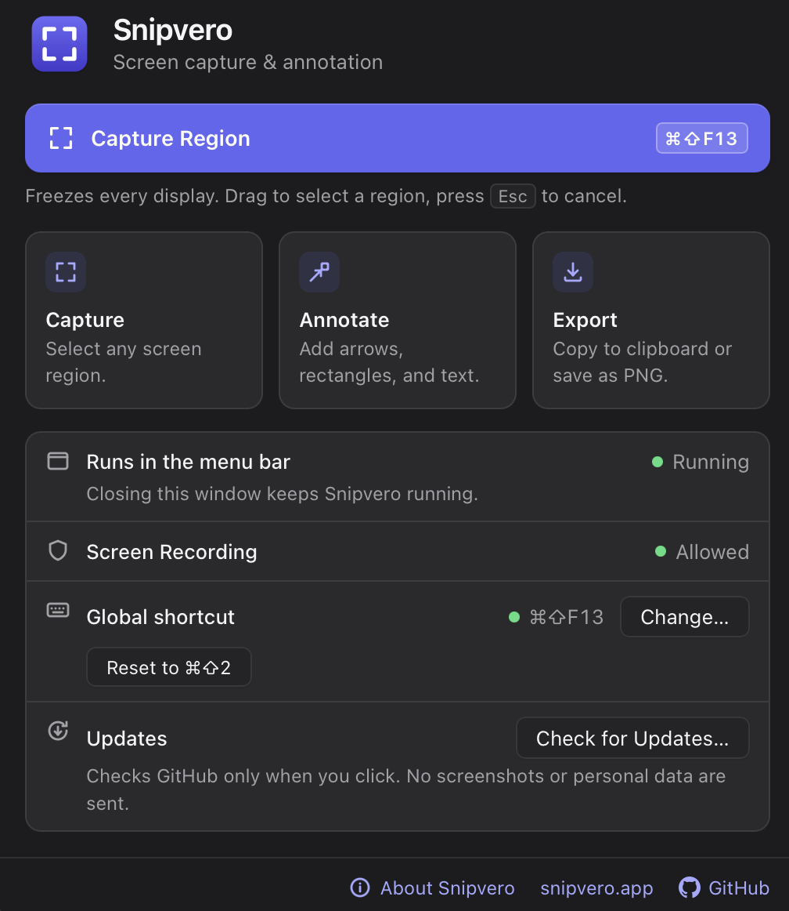
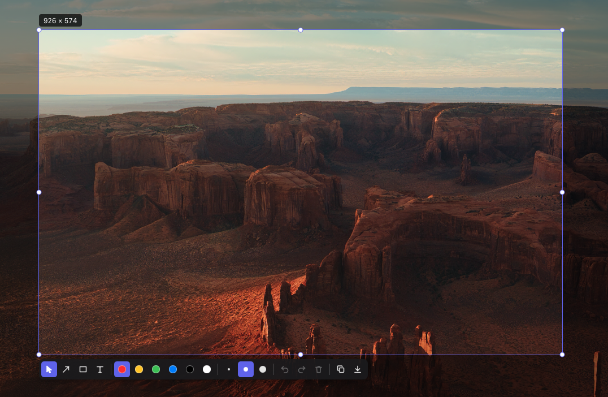
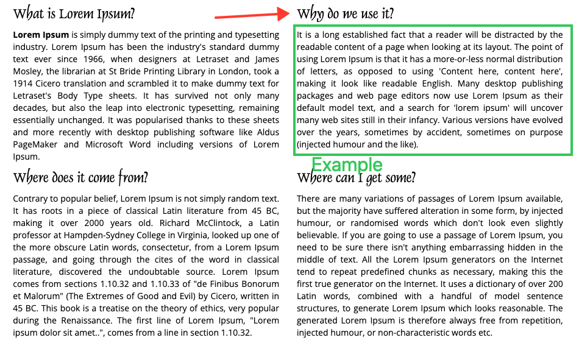

# Snipvero

Snipvero is a free, open-source screenshot tool for the Mac. It sits in the menu bar until you
need it: press a shortcut, the screen freezes, and you drag out the part you want. Point at things
with arrows, frame them with rectangles, add a note, then copy the result or save it as a PNG.
Everything happens on your computer. Snipvero connects to the internet only when you ask it to
check for updates.

**Website:** [snipvero.app](https://snipvero.app) ·
**Support:** [support@snipvero.app](mailto:support@snipvero.app)

> **Status: beta (0.1.0-beta.4).** macOS on Apple silicon is the only supported platform. See
> [Download](#download) and [Known limitations](#known-limitations).

## Features

- **Instant capture** from a global shortcut (<kbd>Cmd</kbd>+<kbd>Shift</kbd>+<kbd>2</kbd>) or the
  menu bar icon. All displays freeze together, so nothing moves while you select.
  Change the shortcut from the main window's **Global shortcut** row; it is kept across restarts.
- **Region selection** on any display: drag in any direction, then move the region or resize it
  from eight handles. A live label shows its size in pixels.
- **Annotations:** arrows, outlined rectangles and text in six colours and three sizes. Select,
  move, resize, re-edit and delete them, with full undo and redo. Text supports any language your
  keyboard can type.
- **Sharp on Retina:** the image keeps the display's full pixel resolution, including setups that
  mix Retina and standard displays.
- **Copy or save:** copy to the clipboard (PNG and TIFF) or save a PNG through the standard save
  panel. Afterwards focus returns to the app you were using.
- **Light footprint:** a menu bar app with no Dock icon, built on Tauri and the system web view.

## Screenshots

<p align="center">
  
</p>
<p align="center"><em>The Snipvero window: start a capture and check permission and shortcut status.</em></p>

<table>
  <tr>
    <td width="50%"></td>
    <td width="50%"></td>
  </tr>
  <tr>
    <td align="center"><em>Select a region, then pick a tool, colour and size.</em></td>
    <td align="center"><em>The result with an arrow, a rectangle and a text note.</em></td>
  </tr>
</table>

## Platform support

| Platform                   | Status                                                          |
| -------------------------- | --------------------------------------------------------------- |
| macOS 14 (Sonoma) or later | Supported (beta), Apple silicon (M1 or later)                   |
| Windows 10 (1903+) and 11  | Planned. The code builds in CI, but capture is not written yet. |

Intel Macs are not supported by the beta: an Intel or universal build has not been made or tested.

## Download

The macOS beta is available as a disk image (`.dmg`) for Apple silicon from
[GitHub Releases](https://github.com/ugokkaya/Snipvero/releases/tag/v0.1.0-beta.4). Each
release lists the SHA-256 checksum of its disk image in `SHA256SUMS.txt`. You need macOS 14 or
later on a Mac with Apple silicon (M1 or later).

1. Download the `.dmg` from the release and open it.
2. Drag **Snipvero** into **Applications**.
3. Open Snipvero from Applications.
4. Grant Screen Recording permission when macOS asks for it
   ([Screen Recording permission](#screen-recording-permission)).

**Beta 4 is Developer ID signed and notarized by Apple.** Both the app and DMG have stapled
notarization tickets. The release is for Apple silicon only; no Intel or universal download is
provided. Users upgrading from Beta 1 may need to grant Screen Recording permission again because
the signing identity has changed.

### Install with Homebrew

```sh
brew tap ugokkaya/tap
brew install --cask ugokkaya/tap/snipvero
```

The [official Tap](https://github.com/ugokkaya/homebrew-tap) uses the same signed and notarized
Apple silicon DMG, with a pinned SHA-256. If Homebrew 7 asks you to trust the cask, review it and
run `brew trust --cask ugokkaya/tap/snipvero`, then retry the install. This does not disable
Gatekeeper. If you already installed Snipvero manually, quit it and back up that copy before
switching installation methods; do not force an overwrite.

For an existing Homebrew installation, run `brew update` then
`brew upgrade --cask --greedy ugokkaya/tap/snipvero`. The `--greedy` option includes casks marked
as self-updating, like Snipvero. This installs only the version currently published in the Tap;
committing source changes alone does not update the distributed app.

### Updates

Starting with Beta 3, Snipvero can update itself: click **Check for Updates…** in the **Updates**
row of the Snipvero window, in **About Snipvero**, or in the menu bar menu. Snipvero shows the new version and its release notes, and downloads
nothing until you click **Download and Restart**. It then verifies the update's signature,
replaces the app and reopens. Close any open capture first; Snipvero does not update during one.
If Snipvero sits in a folder you cannot write to, macOS asks for an administrator password in its
own dialog. Snipvero never checks for updates on its own ([Privacy](#privacy)).

Beta 2 and earlier have no update function. To get updates, install Beta 3 or later once from its
DMG as above; later versions can then be installed from the About window.

### Older Beta 1 download

The original `0.1.0-beta.1` asset is retained unchanged. It is not signed with an Apple Developer ID
and has not been notarized by Apple. Gatekeeper may block its first launch. Prefer the current beta; if you
choose the older build, only proceed if you trust its source. If macOS blocks Beta 1:

1. Close the message (do not move Snipvero to the Trash).
2. Open **System Settings → Privacy & Security** and scroll down to **Security**. A note says
   that Snipvero was blocked.
3. Click **Open Anyway**, confirm with your password or Touch ID, then choose **Open**.

macOS remembers this choice for that copy of Snipvero. Do not turn off Gatekeeper for your whole
Mac to run Snipvero. If you prefer not to approve a download, build Snipvero from source instead.

This warning applies only to the older `0.1.0-beta.1` download. New releases must pass Developer ID
signing and Apple notarization checks ([release process](docs/RELEASE.md)).

## Install from source

You can also build Snipvero yourself instead of downloading it.

You need:

- macOS 14 or later on Apple silicon
- Xcode Command Line Tools (`xcode-select --install`)
- [Rust](https://rustup.rs/) 1.90 or later (stable)
- [Node.js](https://nodejs.org/) 22 or later and [pnpm](https://pnpm.io/) (the version CI uses is
  in the `packageManager` field of `package.json`)

```sh
git clone https://github.com/ugokkaya/Snipvero.git
cd Snipvero
pnpm install
pnpm tauri build --bundles app
open src-tauri/target/release/bundle/macos/Snipvero.app
```

To keep it, copy `Snipvero.app` from `src-tauri/target/release/bundle/macos/` into
`/Applications`. No certificate or Apple Developer account is needed: the build is signed ad hoc,
which macOS accepts for apps built on the same Mac. Its icon appears in the menu bar, and the Snipvero
window opens: a **Capture Region** button with its shortcut, the Screen Recording permission
status and links to **About Snipvero**, [snipvero.app](https://snipvero.app) and the GitHub repository.
The About window also lists **support@snipvero.app** under Contact. Clicking it opens a new
message in your default email app; Snipvero does not send email itself.

`pnpm tauri build --bundles app,dmg` also produces a disk image in
`src-tauri/target/release/bundle/dmg/`. An ad-hoc signed disk image is fine for your own use, but
macOS blocks it on other Macs; [docs/RELEASE.md](docs/RELEASE.md) describes signing and
notarization for distribution.

## Screen Recording permission

macOS asks for permission before any app can read the screen. Snipvero needs it to take a
screenshot; it does not record video or audio.

1. Press the capture shortcut or choose **Capture** in the menu bar. macOS shows a permission prompt.
2. Open **System Settings → Privacy & Security → Screen & System Audio Recording** (the Snipvero
   window has an **Open System Settings** button that goes straight there).
3. Turn on **Snipvero**.
4. If capture still does not work, click **Restart Snipvero** in its window or quit and reopen it.

macOS ties this permission to the app's signature. An ad-hoc signed build gets a new signature
every time it is rebuilt, so after a rebuild macOS may ask again or show Snipvero as enabled
without it working. Turning the switch off and on again, or removing Snipvero from the list and
granting it again, fixes that. `tccutil reset ScreenCapture com.snipvero.app` clears the grant
completely. Contributors can avoid the repeated prompts with a stable local signing identity
([AGENTS.md](AGENTS.md)).

Launch the bundled `.app` (Finder or `open`), not the binary inside it from a terminal: macOS
would otherwise attribute the permission to the terminal app.

## Usage

1. Press <kbd>Cmd</kbd>+<kbd>Shift</kbd>+<kbd>2</kbd> or choose **Capture** in the menu bar.
2. Drag to select a region. Drag inside it to move it, or drag a handle to resize it.
3. Pick a tool in the toolbar below the region and draw. Choose **Select and move** (or click the
   active tool again) to move, resize or delete annotations.
4. Copy or save. Press <kbd>Esc</kbd> to leave without doing either.

You can also start a capture with **Capture Region** in the Snipvero window. Closing the window
keeps the app running in the menu bar. Choose **Open Snipvero** to show the window again,
**About Snipvero** for the version and license, or **Quit Snipvero** to quit.

### Keyboard shortcuts

| Shortcut                                                       | Action                                                 |
| -------------------------------------------------------------- | ------------------------------------------------------ |
| <kbd>Cmd</kbd>+<kbd>Shift</kbd>+<kbd>2</kbd>                   | Start a capture (anywhere; can be changed, see below)  |
| <kbd>Return</kbd> or <kbd>Cmd</kbd>+<kbd>C</kbd>               | Copy the region to the clipboard and close             |
| <kbd>Cmd</kbd>+<kbd>S</kbd>                                    | Save the region as PNG                                 |
| <kbd>Cmd</kbd>+<kbd>Z</kbd>                                    | Undo                                                   |
| <kbd>Shift</kbd>+<kbd>Cmd</kbd>+<kbd>Z</kbd>                   | Redo                                                   |
| <kbd>Delete</kbd> or <kbd>Backspace</kbd>                      | Delete the selected annotation                         |
| <kbd>Esc</kbd>                                                 | Finish editing text; otherwise cancel the capture      |
| <kbd>Return</kbd> / <kbd>Cmd</kbd>+<kbd>C</kbd> in a text note | New line / copy the selected text (they do not export) |
| <kbd>Cmd</kbd>+<kbd>S</kbd> in a text note                     | Finish the note and save the region with it            |

To use another capture shortcut, click **Change…** in the Global shortcut row of the Snipvero
window and press the new combination (<kbd>Esc</kbd> cancels). It needs two modifier keys, such as
<kbd>Cmd</kbd>+<kbd>Shift</kbd> or <kbd>Ctrl</kbd>+<kbd>Option</kbd>, or one with a function key,
so other apps keep their own shortcuts. **Reset to ⌘⇧2** restores the default. Snipvero remembers
the choice across restarts.

If another app already uses the shortcut, the Snipvero window says so; choose another one, or use
**Capture** in the menu bar. macOS does not always report a combination another app also uses.

## Privacy

- No accounts, uploads, analytics or crash reporting. Screenshots, annotations and file names
  never leave your Mac.
- The only network access is **Check for Updates…**, and only when you click it; Snipvero never checks at launch or in the background. It asks GitHub over HTTPS for a small
  file describing the newest beta (`raw.githubusercontent.com`) and, if you choose **Download and
  Restart**, downloads the update from the GitHub release (`github.com`, which hands the download
  to `release-assets.githubusercontent.com`). The requests contain no version number, identifier
  or cookie; like any web request, they show GitHub your IP address, the time, and the updater's
  User-Agent (`tauri-plugin-updater/<version>`). GitHub's privacy statement applies to that data.
- The app's content security policy only allows its own local resources. Website and GitHub links
  open in your browser, and only when you click them.
- Screenshots are processed on your Mac and stay in memory; they are discarded when a capture
  ends. Nothing is written to disk unless you save a file, and then only the file you choose.
- A capture shortcut you choose is stored in `~/Library/Application Support/com.snipvero.app/settings.json`.
  The file holds only the shortcut.
- Copying puts the image on the system clipboard, where other apps can read it, as with any copy.

## Known limitations

- Beta software. See [Download](#download) for installation requirements and the older Beta 1 warning.
- A selection stays on one display; it cannot span several displays.
- Only the capture shortcut can be changed: colours and sizes are fixed, and there is no launch at login.
- Unplugging or rearranging displays during a capture ends that capture.
- Apple silicon only; Intel Macs are untested.

## Development

```sh
pnpm install
pnpm tauri dev                            # run with hot reload
pnpm check                                # formatting, lint, type check, tests
pnpm build                                # frontend build, needed before cargo commands
cd src-tauri && cargo fmt --check && cargo clippy --all-targets -- -D warnings && cargo test
```

Capture needs Screen Recording permission, which belongs to a bundled `.app`; see
[AGENTS.md](AGENTS.md) for testing capture during development.

## Contributing

Contributions are welcome. Read [CONTRIBUTING.md](CONTRIBUTING.md) before opening a pull request;
it covers the setup, the checks every pull request must pass and the project's rules on
dependencies and privacy.

## Documentation

- [Requirements](docs/REQUIREMENTS.md)
- [Architecture](docs/ARCHITECTURE.md)
- [Decisions](docs/DECISIONS.md)
- [Release process](docs/RELEASE.md)
- [Contributing](CONTRIBUTING.md)
- [Contributor and coding agent instructions](AGENTS.md)

## License

Snipvero is released under the [MIT License](LICENSE). It is built on open-source libraries that
keep their own licenses (MIT, Apache-2.0, BSD, ISC, Zlib, Unicode, MPL-2.0 and similar); their
notices are in [THIRD_PARTY_NOTICES.txt](THIRD_PARTY_NOTICES.txt), which every app bundle also
contains (`Snipvero.app/Contents/Resources/`).
